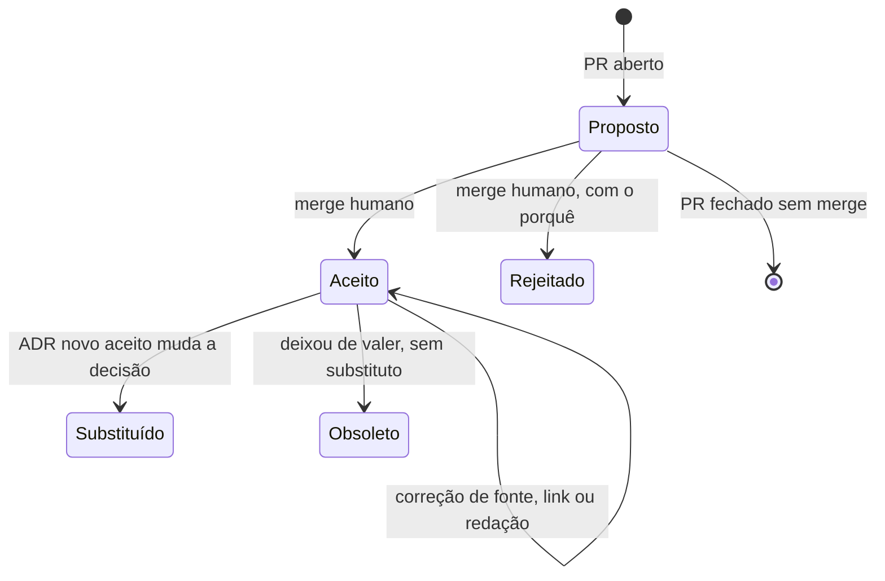
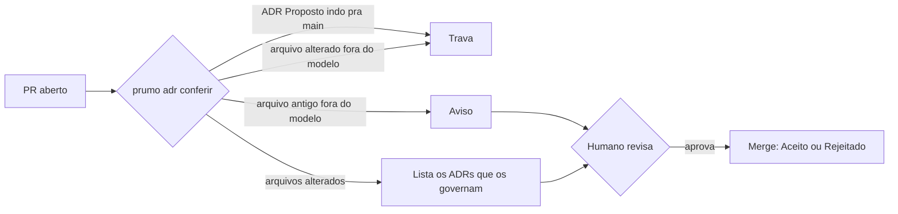

# 0016 · Ciclo de vida do ADR, com o merge humano como transição

- **Status:** Proposto
- **Data:** 2026-11-19

## Contexto
No C0, sete ADRs passaram de Proposto pra Aceito, cada um num PR, e a revalidação mudou o texto de quase todos. Três problemas apareceram:
- O status era só uma palavra no topo do arquivo, sem regra de quando muda. Um ADR Proposto pode morar na `main` indefinidamente (hoje é o caso do [ADR-0014](0014-registro-de-uso-de-ia.md)).
- A regra "ADR aceito também se revalida" ([AGENTS.md](../../AGENTS.md)) não diz o que fazer quando a revalidação muda a decisão: editar o Aceito no lugar ou escrever outro.
- Nada mostra a quem revisa quais decisões valem pros arquivos de um PR. Uma proposta contra o [ADR-0001](0001-arquivos-como-fonte-da-verdade.md) quase passou porque o ADR foi citado de memória ([origem das regras](../origem-das-regras.md#adr-só-se-cita-depois-de-lido)).

O que o mercado faz:
- **Status:** o conjunto que mais se repete é proposto, aceito, rejeitado, obsoleto e substituído[^madr][^eventcatalog].
- **Aceito no merge:** o guia de engenharia do governo britânico diz que, usando GitHub, o status do pull request reflete o status da decisão até ela ser aceita[^gds]. Outros projetos aceitam o ADR quando o pedido de merge é aprovado e só então mesclam, pra que todo ADR no repositório seja uma decisão final[^picodata].
- **Aceito não se reescreve:** no Log4brains, um ADR é imutável e só o status muda[^log4brains]; a AWS recomenda que a decisão nova marque a antiga como substituída e a mantenha no registro[^aws].
- **Decisão ligada ao código:** o adrkit acrescenta um campo que diz o que cada ADR afeta, pra responder quais decisões governam um pull request[^adrkit].

## Decisão
1. **Status possíveis:** Proposto, Aceito, Rejeitado, Obsoleto e Substituído por ADR-NNNN.
2. **Proposto só existe no PR.** O merge humano é a transição: antes de mesclar, o PR troca o status pra Aceito, ou pra Rejeitado quando a decisão é recusada e vale guardar o porquê. O verificador trava PR que leve um ADR Proposto pra `main`.
3. **Aceito não muda de decisão.** Revalidação que só corrige fonte, link ou redação edita o Aceito no lugar. Revalidação que muda a decisão gera um ADR novo; o antigo passa a "Substituído por ADR-NNNN", e só o status e o link mudam nele. Decisão que deixou de valer sem substituta passa a Obsoleto.
4. **Rigoroso no que muda, tolerante com o passado.** As regras valem à risca pros arquivos que o PR altera. Arquivo antigo que o PR não toca só gera aviso. Assim nada novo nasce errado, e o passado se ajusta quando alguém mexe nele. É decisão do projeto, sem fonte de mercado.
5. **Cada ADR declara o que governa** num campo `Afeta` (caminhos do repositório ou temas). O verificador lista no PR os ADRs que governam os arquivos alterados, pra quem revisa conferir se o PR contradiz algum.
6. **O verificador é do núcleo, por modelo.** A máquina de estados e as regras são regra de negócio e moram no núcleo em Go ([ADR-0006](0006-execucao-local-first-e-stack.md)), num comando como `prumo adr conferir`. As regras do modelo do ADR ficam num arquivo separado do motor. A forja (hoje o GitHub) só dispara o comando.
7. **Começa pelo ADR.** SPEC e PLAN também são artefatos de etapa com modelo, mas o validador genérico só nasce quando o segundo modelo existir. Construir antes é funcionalidade presumida: custa construir e atrasa o que importa agora[^yagni].

O verificador no PR:

## Consequências
- O que está na `main` é decisão tomada. Pra ver o que está em discussão, olhe os PRs abertos.
- O [ADR-0014](0014-registro-de-uso-de-ia.md), hoje Proposto na `main`, passa a gerar aviso até ser decidido num PR (Aceito, Rejeitado ou retirado).
- Onde moram a SPEC e o PLAN de uma tarefa do próprio Prumo, e como a pasta se chama, viram o próximo ADR; se ele mudar o [ADR-0001](0001-arquivos-como-fonte-da-verdade.md), o 0001 passa a Substituído.
- O modelo de ADR (`0000-modelo.md`) e a explicação da pasta ganham os status novos e o campo `Afeta` no mesmo PR que implementar o verificador.
- O verificador de referências do site ([processo](../processo.md)) continua cuidando de links e notas; o de ADR cuida de estrutura e status. Se um absorver o outro, é decisão do PLAN.

## Fontes
[^madr]: MADR, *Markdown Architectural Decision Records* · https://adr.github.io/madr
[^eventcatalog]: EventCatalog, *What are architecture decision records?* (status e significados) · https://www.eventcatalog.dev/docs/development/guides/resources/adrs/introduction.md
[^gds]: GDS Way (governo do Reino Unido), *Documenting architecture decisions* · https://gds-way.digital.cabinet-office.gov.uk/standards/architecture-decisions.html
[^picodata]: Picodata, *decisions/README.md* (ADR aceito quando o pedido de merge é aprovado) · https://git.picodata.io/core/picodata/-/blame/178eb9e77f8d5578f1de74384a2768f8021479bf/decisions/README.md?page=1
[^log4brains]: Log4brains (README) · https://github.com/thomvaill/log4brains/
[^aws]: AWS Prescriptive Guidance, *ADR best practices* · https://docs.aws.amazon.com/prescriptive-guidance/latest/architectural-decision-records/best-practices.html
[^adrkit]: adrkit (wiki) · https://github.com/mbeacom/adrkit/wiki
[^yagni]: Martin Fowler, *Yagni* · https://www.martinfowler.com/bliki/Yagni.html
