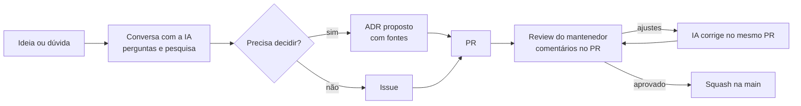

# Como o Prumo é construído (com IA)

O Prumo é uma ferramenta pra construir software com IA em etapas com portões. Ele também é construído assim, desde o primeiro commit. Este documento conta como, pra quem quer estudar o processo ou repetir em outro projeto.

Não é um processo "totalmente automático", e isso é de propósito. A IA pesquisa, escreve e testa; as pessoas decidem, revisam e aprovam. O que dá pra automatizar sem perder controle vai sendo automatizado, e cada passo fica registrado aqui.

## Quem faz o quê

| Quem | Papel |
| --- | --- |
| Mantenedor | Decide (aceita ADRs), revisa e aprova todo PR, faz os merges |
| IA de conversa (Claude) | Pesquisa a literatura, propõe decisões com fontes, escreve ADRs, código e testes, abre issues e PRs, corrige o que o review apontar |
| IA no navegador (Claude in Chrome) | Faz no site do GitHub o que a API não permite, como configurações do repositório |
| IA na máquina do mantenedor (Claude Code) | Instala, roda e testa o projeto num ambiente real, diferente do da IA de conversa |

## O ciclo



1. **A conversa anda por perguntas.** A IA pergunta, o mantenedor responde, e a IA transforma as respostas em ADR ou issue. Ideia que aparece no meio vira issue com a label `ideia`, pra não desviar o checkpoint (ver [processo](processo.md)).
2. **Rascunho é livre, registro é no GitHub.** Ideias podem nascer em qualquer caderno ou quadro, de qualquer pessoa. O mantenedor usa um quadro visual privado como caderno. Mas só existe pro projeto o que vira issue, ADR ou PR aqui.
3. **Decisão tem fonte.** Toda escolha relevante cita a literatura ou a documentação oficial que a sustenta, pra ninguém depender só da palavra da IA.
4. **Review é no PR.** O mantenedor comenta nas linhas; a IA corrige no mesmo PR e a conversa fica registrada. Exemplo: o suporte a workspaces com vários repositórios entrou no [ADR-0007](adr/0007-modelo-de-execucao.md) a partir de um comentário de review.
5. **Teste em ambiente real.** A IA de conversa roda os testes no ambiente dela (Linux), e a IA na máquina do mantenedor roda no Windows. Foi assim que apareceram dois problemas que só existiam no Windows: testes com caminhos de Linux e a marca BOM que o PowerShell 5.1 põe na entrada por pipe.

## Passar trabalho entre as IAs

As três IAs não conversam entre si. O mantenedor leva e traz, e pra isso não virar telefone sem fio usamos um formato fixo:

- a IA de conversa escreve um **prompt de passagem**, com passos numerados, regras do que não pode fazer e quando parar;
- o prompt termina pedindo um **bloco de retorno** com campos fixos;
- o mantenedor cola o bloco de volta na conversa, e a IA segue a partir dele.

Modelo:

```
Faça só isto: <passos numerados>.
Regras: não faça commit nem push; não instale nada sem confirmação; se pedir senha ou 2FA, pare.
Se algum passo falhar, pare e explique o erro.

Devolva:
NOME-DO-BLOCO
campo_1: ok|falhou
campo_2: <valor>
observacoes: <o que deu errado>
```

## Regras que valem pra qualquer IA aqui

Estão no [AGENTS.md](../AGENTS.md). As principais:

- Nada de segredo, dado pessoal, dado de cliente ou código de licença incompatível em código, issue, PR ou prompt.
- Nada de link de sessão, conversa ou conta privada em commit, issue ou PR. A linha `Co-Authored-By` credita a IA, e isso basta.
- Quem envia responde por cada linha: o mantenedor só aprova o que entende.
- PRs saem direto da `main` e são independentes, sem empilhar um em cima do outro.

## O que ainda é manual, e por quê

| Passo | Por que não é automático |
| --- | --- |
| Aceitar decisões e aprovar PRs | É o portão humano, a tese do próprio Prumo |
| Configurações do GitHub | A API não permite tudo, e algumas pedem senha ou 2FA |
| Levar prompts e blocos entre as IAs | As IAs rodam em ambientes separados; a automação disso é estudada na issue #37 |
