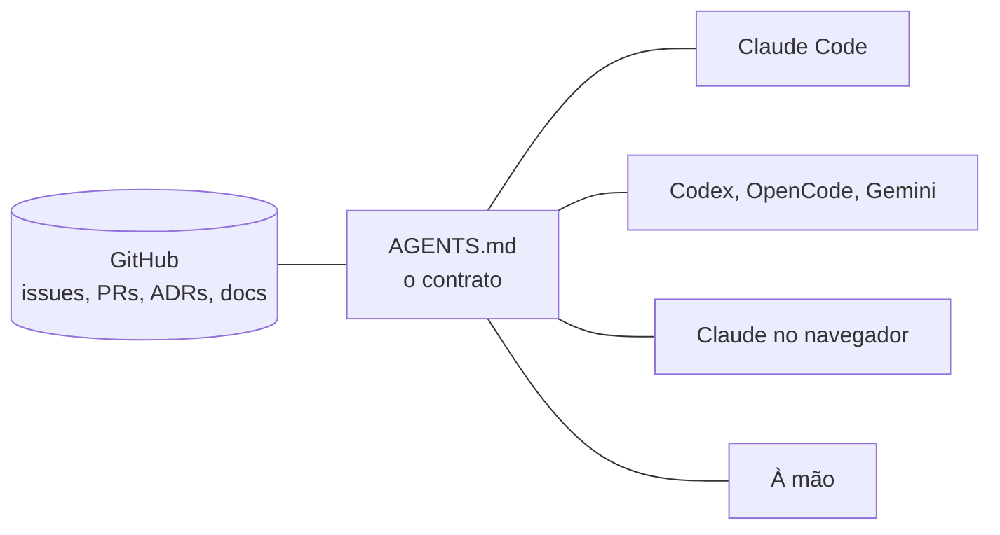

# Jeitos de trabalhar no Prumo

Dá pra contribuir com o Prumo de vários jeitos: à mão, com um agente no terminal, com IA no navegador. Esta pasta documenta cada um, pra quem chega poder copiar o estilo que combina com ele.

## O que é igual em todos

- **O estado do projeto mora no GitHub.** Decisão é ADR, tarefa é issue, conversa de review é comentário no PR. Nada importante fica preso numa ferramenta ou numa conversa.
- **O [AGENTS.md](../../AGENTS.md) é o contrato.** Qualquer agente lê primeiro e segue as regras dele.
- **Cada ferramenta é um adaptador fino.** Trocar de ferramenta não muda o processo, só o jeito de chegar nele. É a mesma ideia de portas e adaptadores que o Prumo usa no código ([ADR-0005](../adr/0005-integracoes-terceirizadas-caminho-nativo.md)).

## O dia a dia, em qualquer ferramenta

| Quero | Como |
| --- | --- |
| Saber o que fazer agora | Ler a issue "Resumo diário" (label `automacao`) e os PRs abertos |
| Decidir algo | Responder na issue ou no PR; decisão de arquitetura vira ADR |
| Anotar uma ideia fora da caixa | Abrir issue com o modelo **Ideia** (label `ideia`, sem checkpoint) |
| Revisar um PR | Ler na ordem que o PR sugere e comentar nas linhas |
| Entender como algo funciona | `docs/`, os ADRs e o [como o Prumo é construído](../como-o-prumo-e-construido.md) |

## Guias por ferramenta

| Guia | Pra quem |
| --- | --- |
| [Claude Code no seu computador](claude-code-local.md) | Quem quer um agente no terminal, no VS Code ou num canvas como o Maestri |
| [Claude no navegador](claude-ai.md) | Quem usa o claude.ai, inclusive pra design system e protótipos |
| [Outros agentes](outros-agentes.md) | Codex, OpenCode, Gemini e afins |

Usa outro jeito? Escreva um guia aqui no mesmo formato e abra um PR.
