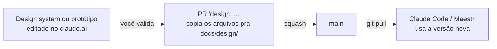

# Claude no navegador (claude.ai)

Foi assim que o Prumo começou: conversa no claude.ai, com quadros, design system e protótipos como artefatos, o Claude in Chrome pras configurações do GitHub e o Claude Code na máquina do mantenedor pra testar. A história está em [como o Prumo é construído](../como-o-prumo-e-construido.md).

## Quando vale

- **Design system e protótipos.** Os artefatos de design do claude.ai são o jeito mais confortável de desenhar telas e tokens visualmente, ver modo claro e escuro e iterar.
- **Pensar alto antes de decidir.** Conversa longa, pesquisa com fontes, rascunho num quadro.

## Quando não vale

- **Trabalho do dia a dia no código.** Aqui o trabalho fica dividido entre ferramentas (chat, navegador, terminal) e o mantenedor vira o carteiro entre elas. O [Claude Code local](claude-code-local.md) junta tudo num agente só.

## Design e protótipos: do claude.ai pro repositório

O design system e os protótipos são editados no claude.ai, mas a versão que vale é a que está no repositório:

1. Você muda e valida o design no claude.ai.
2. Pede pra IA abrir um PR copiando os arquivos (tokens, README, componentes, HTML do protótipo) pra `docs/design/`.
3. Revisa e faz o squash. Quem trabalha no código pega a versão nova com `git pull`.

Regra: **não edite `docs/design/` à mão.** A fonte é o artefato; o repositório guarda a versão publicada. Quando a interface web existir, os tokens viram código (variáveis CSS) e o design passa a morar só no repositório.

## Passar trabalho entre ferramentas

Quando uma tarefa precisa de outra ferramenta (o navegador, a máquina local), use o prompt de passagem com bloco de retorno descrito em [como o Prumo é construído](../como-o-prumo-e-construido.md).
